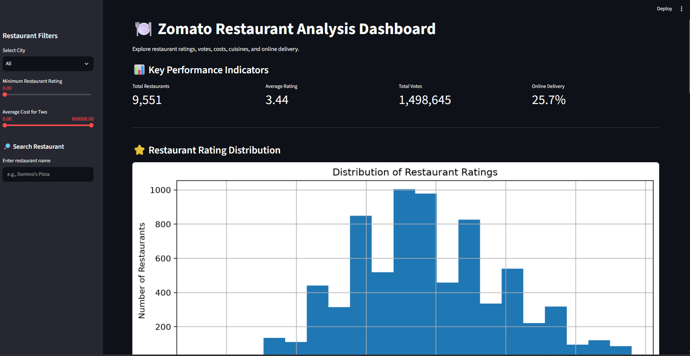
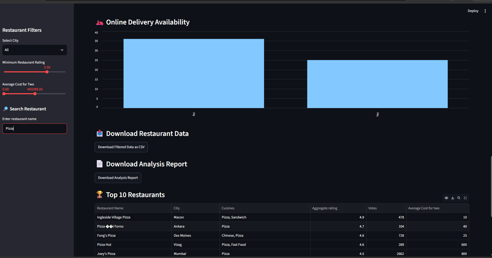

# Zomato Restaurant Data Analysis Dashboard

An interactive data analysis project built using Python, Pandas, Plotly, and Streamlit to explore Zomato restaurant data and identify insights about ratings, pricing, cuisines, locations, and online delivery.

## Live Dashboard

**Explore the deployed dashboard:**
https://python-ml-practice-hq8zqbu4zjcn34qt6wxw5h.streamlit.app/

## Project Overview

This project analyzes Zomato restaurant data using Python and data analysis libraries. It includes data cleaning, feature engineering, exploratory data analysis (EDA), and interactive visualizations.

The Streamlit dashboard allows users to explore restaurant information using filters and interactive charts.

## Technologies Used

- Python
- Pandas
- NumPy
- Matplotlib
- Seaborn
- Plotly
- Streamlit
- CSV data processing
- Git and GitHub

## Key Features

- Restaurant data cleaning and feature engineering
- City-wise restaurant and rating analysis
- Price and rating analysis
- Country-wise rating analysis
- Online delivery analysis
- Restaurant ranking based on ratings and votes
- Correlation analysis
- Interactive dashboard with filters
- Key Performance Indicators (KPIs)
- Interactive Plotly charts with hover details
- Filtered restaurant data display
- Filtered CSV export
- Downloadable analysis report

## Dashboard Screenshots

### Dashboard Overview



### Data Analysis and Visualizations



## Project Structure

- `zomato_analysis.py` — Main data analysis
- `feature_engineering.py` — Feature preparation
- `zomato_city_rating_analysis.py` — City-wise analysis
- `zomato_country_analysis.py` — Country-wise analysis
- `zomato_delivery_analysis.py` — Online delivery analysis
- `zomato_price_rating_analysis.py` — Price and rating analysis
- `zomato_price_category_analysis.py` — Price category analysis
- `zomato_top_restaurants.py` — Restaurant ranking
- `zomato_correlation_analysis.py` — Correlation analysis
- `zomato_dashboard.py` — Interactive Streamlit dashboard
- `zomato_cleaned.csv` — Cleaned dataset
- `requirements.txt` — Project dependencies

## How to Run the Project

### 1. Clone the repository

```bash
git clone https://github.com/madhupulugu36-glitch/python-ml-practice.git
```

### 2. Navigate to the project directory

```bash
cd python-ml-practice/02_Zomato_Restaurant_Project
```

### 3. Create and activate a virtual environment

For Windows CMD:

```cmd
python -m venv .venv
.venv\Scripts\activate
```

### 4. Install dependencies

```bash
python -m pip install -r requirements.txt
```

### 5. Launch the dashboard

```bash
python -m streamlit run zomato_dashboard.py
```

The dashboard will open in your browser.

**Note:** The project requires the cleaned dataset `zomato_cleaned.csv` in the project folder. If you are using the original dataset, ensure that its source license permits your intended use.

## Learning Outcomes

- Data cleaning and preprocessing
- Exploratory Data Analysis (EDA)
- Data visualization using Matplotlib and Plotly
- Feature engineering
- Data filtering and aggregation
- Interactive dashboard development using Streamlit
- Working with CSV datasets
- Git and GitHub version control
- Deploying a Streamlit application

## Author

**Madhu Pulugu**

## Note

This project was developed for learning and portfolio purposes. Dataset ownership and licensing remain with their respective owners.