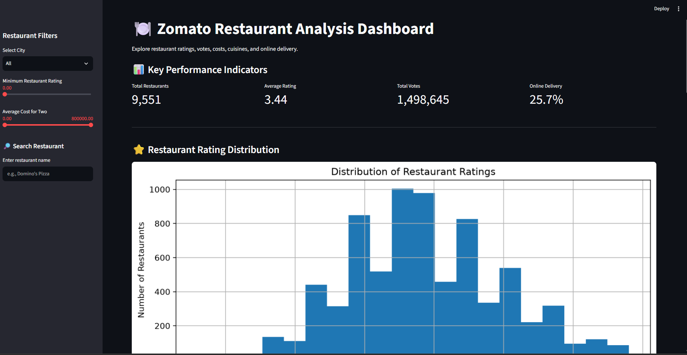
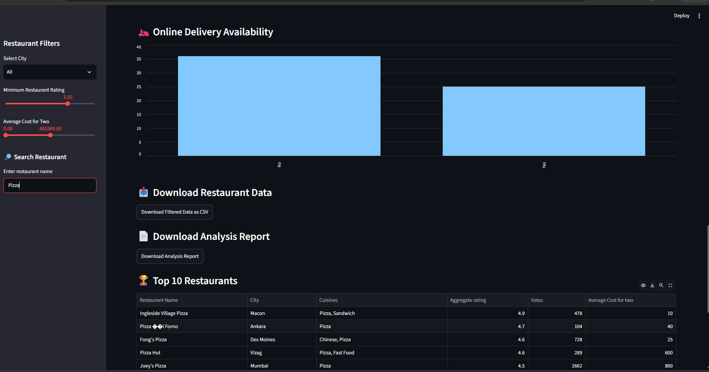

# \# Zomato Restaurant Data Analysis Dashboard


#### \## Project Overview

This project analyzes Zomato restaurant data using Python and data analysis libraries. It explores restaurant ratings, costs, cuisines, city-wise distribution, votes, and online delivery trends through data analysis and an interactive Streamlit dashboard.


##### \## Technologies Used

\- Python

\- Pandas

\- Matplotlib

\- Streamlit

\- CSV data processing

\- Git and GitHub


##### \## Key Features

\- Restaurant data cleaning and feature engineering

\- City-wise restaurant and rating analysis

\- Price and rating analysis

\- Country-wise rating analysis

\- Online delivery analysis

\- Restaurant ranking based on ratings and votes

\- Correlation analysis

\- Interactive dashboard with filters

\- Key performance indicators (KPIs)

\- Data visualization and filtered CSV export

\- Downloadable analysis report


##### \## Project Structure

\- `zomato\_analysis.py` — Main data analysis

\- `feature\_engineering.py` — Feature preparation

\- `zomato\_city\_rating\_analysis.py` — City-wise analysis

\- `zomato\_country\_analysis.py` — Country-wise analysis

\- `zomato\_delivery\_analysis.py` — Online delivery analysis

\- `zomato\_price\_rating\_analysis.py` — Price and rating analysis

\- `zomato\_price\_category\_analysis.py` — Price category analysis

\- `zomato\_top\_restaurants.py` — Restaurant ranking

\- `zomato\_correlation\_analysis.py` — Correlation analysis

\- `zomato\_dashboard.py` — Interactive Streamlit dashboard


\## How to Run the Project


\### 1. Clone the repository

```bash

git clone https://github.com/madhupulugu36-glitch/python-ml-practice.git

```


\### 2. Navigate to the project directory

```bash

cd python-ml-practice/02\_Zomato\_Restaurant\_Project

```


\### 3. Install dependencies

```bash

pip install pandas matplotlib streamlit

```


\### 4. Add the dataset

Obtain the Zomato dataset from its original source, ensuring that its license permits your intended use. Place the required CSV files in this project folder.


\### 5. Launch the dashboard

```bash

streamlit run zomato\_dashboard.py

```


\## Learning Outcomes

\- Data cleaning and preprocessing

\- Exploratory Data Analysis (EDA)

\- Data visualization

\- Feature engineering

\- Data filtering and aggregation

\- Interactive dashboard development

\- Git and GitHub version control


\## Author

Madhu Pulugu


\## Note

This project was developed for learning and portfolio purposes. Dataset ownership and licensing remain with their respective owners.

## Dashboard Screenshots

### Dashboard Overview


### Data Analysis and Visualizations

